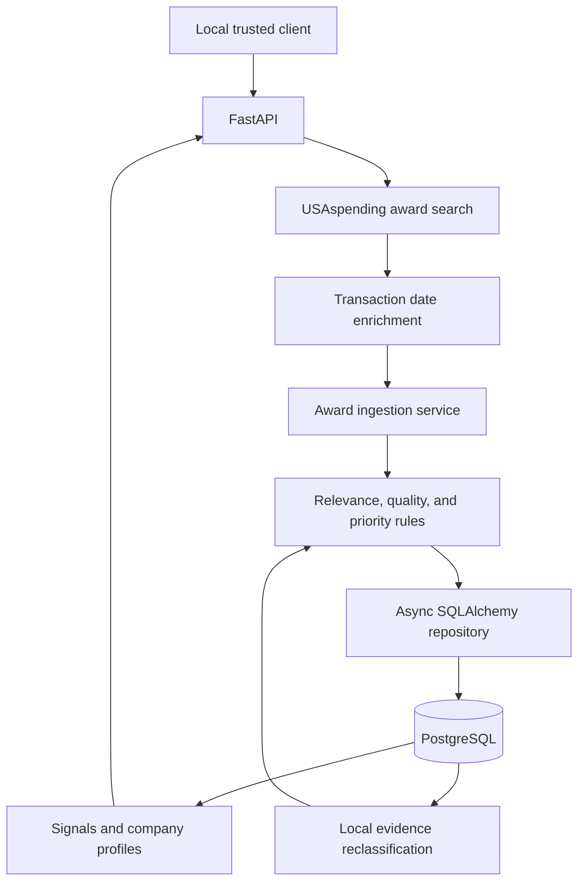

# Architecture

This document describes current development beyond the tagged
`v0.1.0-alpha.2` release. The runtime version remains `0.1.0-alpha.2`.

## System flow

A source adapter normalizes external records into `AwardRecord`. The service
scores them and persists relevant awards with derived `CompanySignal` records.
The API exposes ranked signals and aggregated company profiles. It does not
currently retain every fetched award that fails initial relevance scoring.

## Package responsibilities

| Module | Responsibility |
| --- | --- |
| `api.py` | App lifecycle, HTTP validation, queries, and ingestion/reclassification routes |
| `cli.py` | Local Uvicorn entry point |
| `config.py` | `ORBITAL_SIGNAL_*` settings and `.env` loading |
| `domain.py` | Typed evidence, assessment, signal, profile, and result models |
| `sources/usaspending.py` | Source requests, selective retries, parsing, date enrichment |
| `relevance.py` | Explainable space-sector relevance |
| `quality.py` | Recipient type and startup-candidate event eligibility |
| `priority.py` | Explainable attention ranking using evidence and recency |
| `profiles.py` | Company grouping and profile aggregation |
| `services.py` | Ingestion and local reclassification orchestration |
| `repository.py` | Storage protocol and isolated in-memory test implementation |
| `database.py`, `db_models.py` | Async SQLAlchemy setup and relational schema |
| `sql_repository.py` | Durable evidence, identities, signals, and ingestion-run persistence |
| `migrations/` | Alembic schema history |

## Evidence, classifications, and dates

`AwardRecord` preserves source and award identifiers, generated internal ID,
recipient name and UEI, award amount, agency, description, evidence URL,
transaction action date, award start/end dates, and optional industry codes.

`CompanySignal` combines that evidence with relevance points and reasons,
matched terms, organization type, candidate eligibility, quality flags, and
priority points and reasons. Classification is deterministic; it does not use a
language model.

The three assessments answer different questions:

| Assessment | Meaning |
| --- | --- |
| Relevance | Does the evidence relate to space activity? |
| Quality | Does this recipient and event qualify for the heuristic candidate feed? |
| Priority | How should this signal rank for attention as of a supplied date? |

The relevance threshold defaults to `4`. Strong space terms, supporting terms,
agency evidence, and optional NAICS/PSC codes contribute points; agency
membership alone is insufficient. The USAspending adapter currently supplies
agency and text evidence, without classification codes. Phrase boundaries and
an `orbital welding` exclusion reduce known false positives.

Quality rules exclude academic/research, government/nonprofit, unknown
recipients, known established contractors, low-dollar events, and selected
administrative or training purchases from the candidate feed. Their relevant
evidence can remain in the broader signal feed.

Priority combines bounded relevance points, action-date recency, candidate
eligibility, amount bands, and technology terms. Future-dated actions receive
no recency boost. Its stored score changes only on ingestion or explicit
reclassification; it does not decay automatically.

`occurred_on` selects `action_date`, falling back to `start_date`. Recency
scoring uses only `action_date`. Award dates, requested search range, and first
observation (`detected_at`) are distinct. The source adapter enriches the latest
transaction date, which can fall outside the requested search window.

## Durable model

| Table | Purpose |
| --- | --- |
| `companies` | Canonical organization identities and classification |
| `company_aliases` | Observed source names associated with identities |
| `awards` | Normalized source evidence and separate action/start/end dates |
| `signals` | Current derived classifications and first detection times |
| `ingestion_runs` | Requested ranges, status, counts, and failure diagnostics |

Company matching prefers UEI and falls back cautiously to normalized names.
Distinct UEIs must remain separate even when names match. Ambiguous name-only
evidence is not assigned a known UEI. Profile grouping normalizes UEI casing.
This is deterministic matching rather than verified entity resolution; source
aliases still need interpretation when organizations share or change names.

Award uniqueness is `(source, source_award_id)`. For USAspending, the generated
internal identifier is the canonical source award ID when available; display
award IDs can collide across agencies. The display ID is a fallback only when
the generated identifier is absent.

Signal IDs are normally the first 20 hexadecimal characters of SHA-256 over
`source:source_award_id`. Re-ingestion reuses legacy persisted awards and
signals where the canonical upstream identity can be matched, retaining their
signal IDs and detection history.

Repeated ingestion updates evidence and classifications while preserving first
detection time. The returned `stored_count` counts new signals;
`duplicate_count` counts existing relevant signals processed again, even when
their evidence changes.

Each evidence/signal graph is committed in its own transaction. Ingestion-run
tracking is durable but does not make an entire ingestion atomic. A later
failure can leave earlier awards committed, and interruption recovery is not
automatic.

Reclassification rebuilds derived signals from all retained awards using an
`as_of` date. If an award no longer qualifies, its signal is removed while its
award remains available for subsequent reconsideration. First detection time
survives updates and restoration. The operation does not fetch missing evidence
or make the original ingestion coverage complete.

## API and runtime boundaries

`create_app()` uses `SqlAlchemySignalRepository` by default. Tests can inject a
`SignalRepository` implementation. Engine disposal happens during app shutdown;
schema creation requires `alembic upgrade head` before requests use the database.

The API has no authentication or authorization and is intended for trusted
local use. It exposes ingestion and reclassification mutations, signal filters,
and company summaries. `/health` reports application liveness and version only.
Invalid date ranges return `422`; upstream HTTP failures and malformed upstream
records return `502`.

USAspending ingestion stops at five pages per agency and enriches dates with
bounded concurrency. Both ingestion and reclassification execute within the
request. Company aggregation and reclassification load their input records into
memory. There is no scheduler, queue, durable checkpoint, run-status API,
distributed operation lock, or automatic stale-run recovery.

Company profiles summarize retained signals: count, summed award amount,
agencies, latest signal date, mean relevance, maximum priority, and heuristic
candidate/established-contractor flags. These summaries are not verified company
revenue or complete funding histories.

## Verification

The test suite isolates source access with `httpx.MockTransport`, injects
in-memory repositories for API/service tests, and exercises SQL persistence
against async SQLite. It covers normalization, scoring, filtering, identity,
deduplication, run tracking, and reclassification. PostgreSQL migration and
deployment verification remains a separate operational check.
